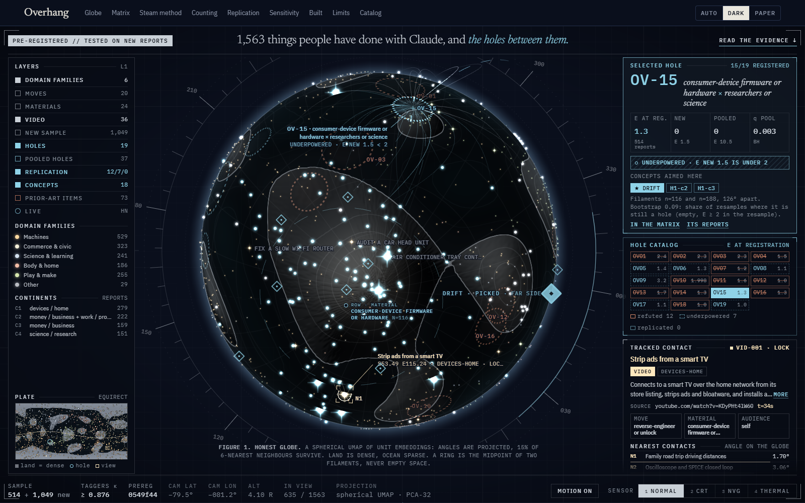
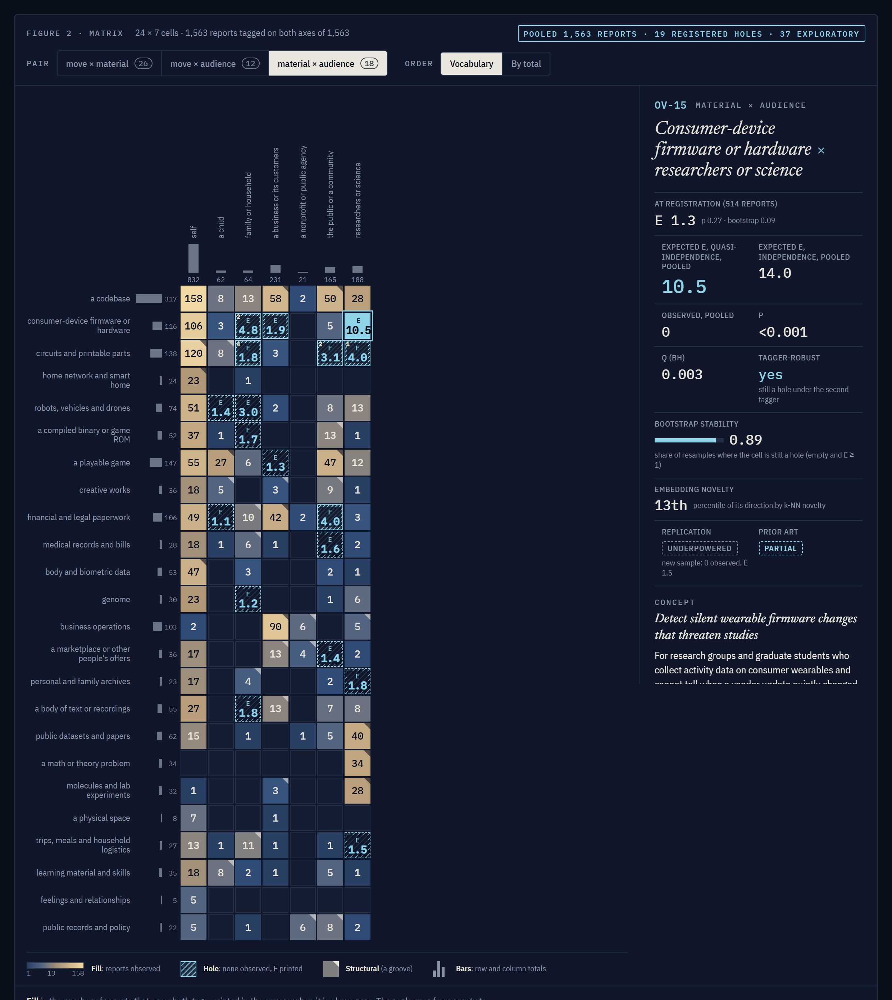
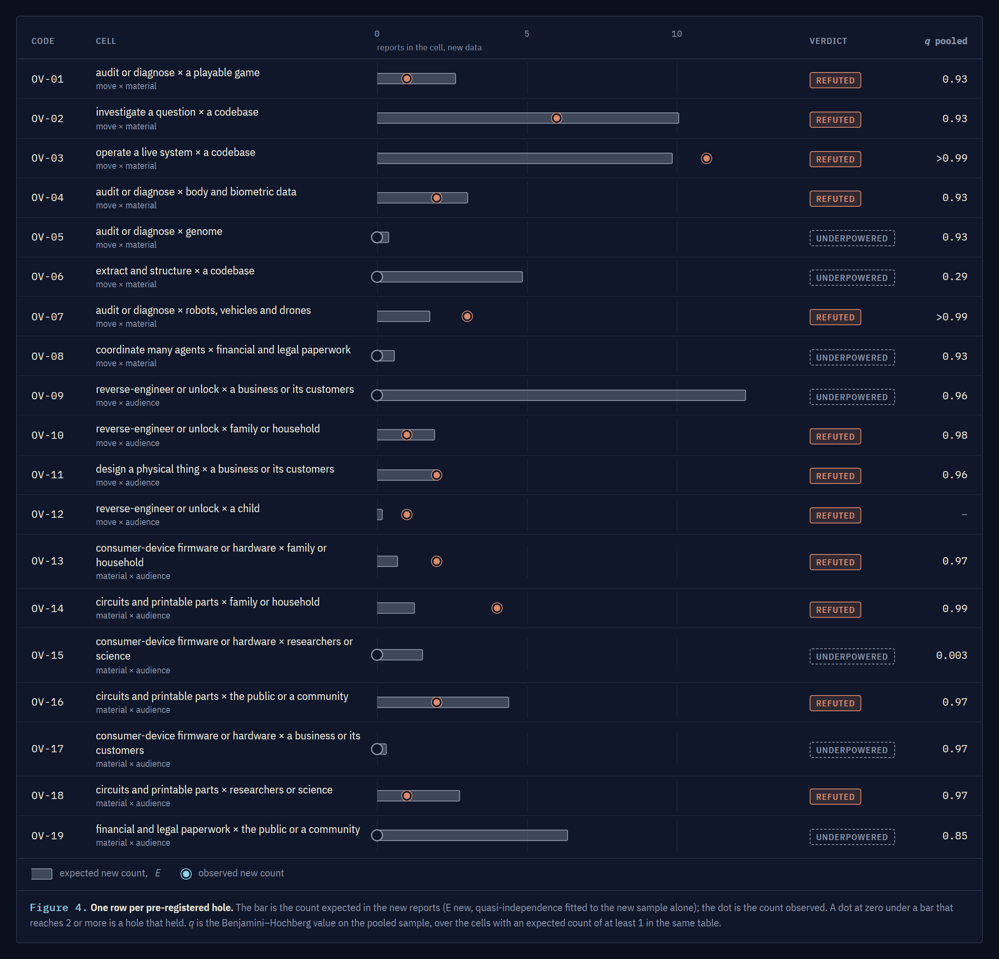
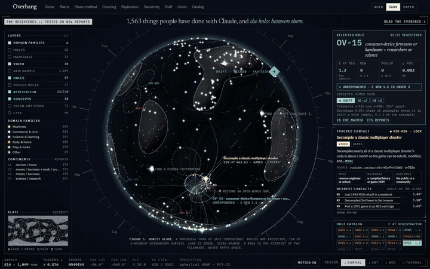
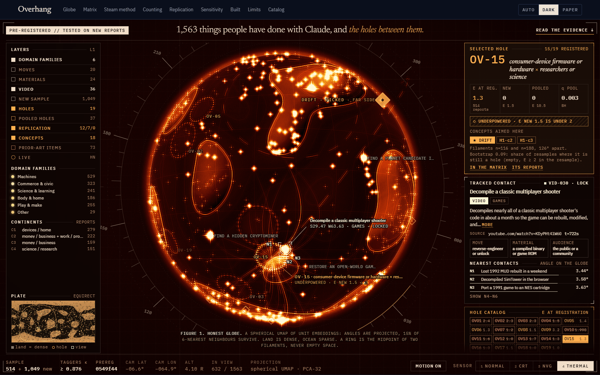
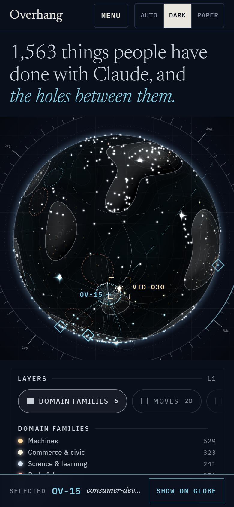

<p align="center">
  
</p>

<h1 align="center">Overhang</h1>

<p align="center">
  <b>A globe of 1,563 things people have done with Claude, the empty places between them,<br>and a pre-registered test of whether those empty places are real.</b>
</p>

<p align="center">
  <a href="LICENSE"></a>
  
  <a href="https://github.com/BaileyPillon/overhang/commit/0549f44"></a>
</p>

<p align="center">
  <a href="app/"><b>The app</b></a> &nbsp;|&nbsp;
  <a href="docs/METHOD.md">Methods</a> &nbsp;|&nbsp;
  <a href="PREREG.md">Pre-registration</a> &nbsp;|&nbsp;
  <a href="docs/gapfind.md">gapfind</a> &nbsp;|&nbsp;
  <a href="#reproduce">Reproduce</a>
</p>

<p align="center"><sub>The pre-registered badge links to a commit on GitHub, so it works only once this repository is pushed under <code>github.com/BaileyPillon/overhang</code>. Until then the same commit is the one named <code>0549f44</code> in a local clone (<code>git show 0549f44</code>), and its date is only as trustworthy as that clone. A public push, a signed tag or an archive snapshot is what makes the timestamp independently checkable.</sub></p>

---

## What this is

- **A corpus and a map.** 1,563 sourced reports of what people have actually done with Claude, each rewritten as one plain sentence, tagged on three facets, embedded, and drawn on an interactive globe and an evidence matrix. Every report links to where we found it.
- **A test of "what is missing?"** Looking for gaps in a pile of ideas finds gaps that are not there. We wrote down 19 candidate holes *before* collecting 1,049 new reports, then checked. The answer was mostly no, and the write-up says so.
- **A thing built anyway, and labelled as such.** One hole was picked after the result, for judgment reasons, and a tool called Drift was built for it. It is reported as an exception, not as a finding.

## The result in one table

| | Result |
|---|---|
| **Corpus** | 514 reports, then 1,563. The extra 1,049 were collected blind: collectors were given one facet value or a random draw, never a combination, and never saw the registered cells. |
| **Tagger agreement** (Cohen's κ: move / material / audience) | First 514: **0.878 / 0.897 / 0.878**. New 1,049: **0.904 / 0.929 / 0.876**. Two blind taggers, then adjudication. |
| **Pre-registered holes** | **19 registered → 0 replicated, 12 refuted, 7 underpowered.** Twelve cells that looked empty at n = 514 were filled by the new sample. The count is 0 under the literal registered wording (OV-06 pooled q 0.497) and under the code's family (0.286); one alternative reading would make it 1 (see [Pre-registration](#pre-registration) and [`results/bh-family-ruling.md`](results/bh-family-ruling.md)). |
| **Sensitivity analysis** (exploratory) | The verdicts that never move are the 12 refutations. What moves is the rest. Under plain independence 6 replicate; under the registered quasi-independence model (z = 3), none; at z = 4, two; at z = 5, one. *Consumer-device firmware × researchers* replicates under independence (new sample alone: 0 observed, 9.5 expected, pooled q < 0.001) but is **underpowered under the pre-registered quasi model** (1.5 expected in the new sample, bar is 2). |
| **Tagging audit** (3 auditors, one hole) | Verdicts: weakened, refuted, weakened. Reverse-engineering of *scientific-grade* instruments for research does exist (two items). No report applies Claude to *consumer-grade* hardware for research. Honest scope of the hole: **consumer hardware in research**. |
| **Drift** | **Picked after the fact**, not earned by the rule. It fills the firmware × researchers cell above (pooled: 0 observed, 10.5 expected, q = 0.003, still empty in 89% of bootstrap resamples). Headline: replaying the same recordings through six generations of Bangle.js firmware (Espruino 2v09 to 2v29, 126 recordings), the median step-count error on Clemson regular gait is +2.7% (2v09), +0.3% (2v10), -0.8% (2v11) and -0.3% from 2v12 on. The boundary shifts are -0.11 points at 2v09 to 2v10 (95% CI -4.22 to +4.27) and -0.90 at 2v10 to 2v11 (-2.43 to +0.72). On the six native Bangle.js walks (one wearer) the 2v09 to 2v10 shift is +35.7 points on average, so the Clemson result does not hold there: the 2v09 to 2v10 and 2v10 to 2v11 boundaries are "not comparable", and 2v11 to 2v12 is "not confirmed" (the Clemson interval is inside ±2 points but the native walks disagree). None is established as comparable. Details and caveats: [`drift/README.md`](drift/README.md). |

<p align="center">
  
  
</p>
<p align="center"><sub>Left: the move × material matrix, with every hole hatched and its expected count printed inside. Right: the replication, one row per pre-registered hole.</sub></p>

The full tables are in the paper inside the app (run it from [`app/`](#the-app), or read the same text in [`docs/METHOD.md`](docs/METHOD.md)) and in [`results/`](results/).

## How it works

```mermaid
flowchart LR
    A["Video: seed use cases"] --> B["Corpus: 514 sourced reports"]
    B --> C["Facet tags: move, material, audience"]
    C --> D["Quasi-independence: how many reports should each cell hold?"]
    D --> E["Pre-registration: 19 holes, commit 0549f44"]
    E --> F["Blind replication: 1,049 new reports"]
    F --> G["Sensitivity analysis and tagging audit"]
    G --> H["Concepts: 18, two embedding models"]
    H --> I["Prior art: 36 searches"]
    I --> J["Judges: 3"]
    J --> K["Drift"]
```



Full detail, with equations, is in [docs/METHOD.md](docs/METHOD.md).

### The Steam method, and why it fails at n = 514

The idea that started this was to embed every game on Steam (146,060 of them), sample 320,000 points *between* games, and keep the points farthest from any real game. With that many games the space is dense, so "far from every game" can mean "no game is there".

We ran the same recipe on our first 514 reports (20 gaps kept, 9 reruns with different seeds and PCA sizes):

- Every gap sat **0.84 to 0.95 cosine** from an existing report (median 0.90). A blend of two reports lands beside them. It is a smear, not a hole.
- Only **1 of 20** gaps came back in all 9 reruns. **5** never came back. A random direction is matched 2.6% of the time; 15 of 20 beat that, but the median gap was found again in only 39% of reruns.
- Stability cannot rescue it, because a blend of two particular reports is found again whenever those two are sampled. Reproducible is not the same as real.

So we changed the question from "where is nothing?" to "which *combinations* has nobody reported?"

### Facet holes

Every report gets three tags: a **move** (what Claude does, 20 values), a **material** (what it acts on, 24) and an **audience** (who it is for, 7). Pairing the tags gives three tables: move × material, move × audience, material × audience. If the two tags were unrelated, a cell would hold

$$E_{ij}=\frac{n_i\,n_j}{N}$$

reports. A **hole** is an empty cell where that number is at least 1. Plain independence is too crude (some pairings are populated by design), so cells with a large positive residual are flagged as structural and the expectation is refitted without them: *quasi-independence*. The registered list is in [PREREG.md](PREREG.md).

### Pre-registration

Candidate holes found in a sample are hypotheses, because the choosing is where the luck gets in. Before any new report existed we committed the list of 19 holes, their expected counts, and the rule: [`0549f44`](https://github.com/BaileyPillon/overhang/commit/0549f44). A hole **replicates** if it stays empty in the new sample, the new sample alone expects at least 2 reports there, and its pooled Benjamini-Hochberg q is at most 0.10. It is **refuted** if the new sample puts any report in it. Otherwise it is **underpowered**. The thresholds and the three verdicts were not changed after the data came in. **The official result is 0 of 19 replicated, and it does not depend on which Benjamini-Hochberg family you pick, with one exception that is reported as a sensitivity.** [`PREREG.md`](PREREG.md) says q is corrected "across all empty cells of its axis pair". The code (`gapfind.facets.cell_pq`) corrects across *every* cell with expected count at least 1, empty or not (families of 161, 99 and 96 cells), and was written after registration but before any replication result was seen. The pooled q of the closest candidate, *OV-06* (extract and structure × a codebase; 0 observed, 4.86 expected in the new sample), under the three readings:

| reading of the family | family size m | OV-06 pooled q | passes q &le; 0.10? | replicated, of 19 |
|---|---|---|---|---|
| **literal registered wording**: all empty cells of the pair | 280 | **0.497** | no | **0** |
| the code's family: all cells with E &ge; 1 | 161 | 0.286 | no | **0** |
| alternative (sensitivity, not the result): empty cells with E &ge; 1 | 21 | 0.037 | yes | 1 |

OV-15 passes the q gate under every reading and fails the registered E<sub>new</sub> &ge; 2 gate at 1.53, so it is underpowered under all three. The alternative reading is not what the registration says, so it is reported beside the result and never as the result. The registered wording gives q = 0.497 for OV-06, not 0.037. The full table for the four candidates it matters for, and the ruling, are in [`results/bh-family-ruling.md`](results/bh-family-ruling.md); the numbers for all 19 are in [`results/bh-family-readings.json`](results/bh-family-readings.json), regenerated by `python scripts/bh_family_readings.py`. **The lesson:** a pre-registration has to name its multiple-testing family exactly, because "all empty cells" against "empty cells with E &ge; 1" moves the headline from none to one. The bootstrap has a similar gap: a resample counts a cell as still a hole when it is empty with E at least 2 (the code's default), where the paper and PREREG say 1, so the published stability values (0.09 for OV-15 at registration, 0.89 pooled) use the stricter bar. See [Notes on wording](docs/METHOD.md#notes-on-wording).

### The globe is honest about being a picture

<p align="center">
  
  
</p>

Normalized embeddings live on a hypersphere, so the map is a sphere (a spherical UMAP of 32-dimensional PCA vectors) instead of a flat plate. Continents are dense clusters; oceans are sparse regions. But a 32-dimensional space does not flatten without loss, and we measured it:

- A report's six nearest neighbours on the globe share its domain 45% of the time, against 56% in the full embedding space and 10% by chance.
- Only 15% of those six neighbours are also its six nearest in the full space.

So **nothing is scored on the picture**, and an empty-looking ocean is not evidence. When you select a hole, the globe lights the two groups of reports it sits between (the ones carrying its row value and its column value) and puts the ring at the midpoint of their centres. It never draws a ring in blank space and calls that a hole.

## What we got wrong

- **Most first-pass holes were sampling artifacts.** At n = 514, only one of the 19 registered holes had p < 0.05 even before correcting for the number of cells, and p ranks cells without certifying them. When 1,049 new reports arrived, 12 of the 19 cells were filled. One cell (*operate a live system × a codebase*) got 11 reports, where about 10 were expected.
- **The registration did not name its multiple-testing family exactly.** "All empty cells of the pair" and "empty cells with E at least 1" differ, and the choice moves the headline from none to one replicated (OV-06: q 0.497 literal, 0.286 in the code, 0.037 under the alternative). The official count stays 0 of 19, the alternative is a sensitivity, and the ruling is in [`results/bh-family-ruling.md`](results/bh-family-ruling.md). A pre-registration has to name its family exactly.
- **Quasi-independence is sensitive to which cells count as structural.** Changing one threshold changes the headline from "nothing replicated" (z = 3, registered) to "one" (z = 5), "two" (z = 4) or "six" (plain independence). We kept the registered model as the official one and show the others next to it, labelled exploratory. The honest summary is that the evidence on the surviving cells is model-dependent.
- **The Steam method does not transfer to small corpora.** We tried it first. It produced confident-looking nonsense (see above).
- **The tags define the holes.** Two taggers agree, which shows the labels are repeatable, not that the vocabulary is right. The audit found scientific-grade instruments filed under "molecules and lab experiments", which is exactly what narrowed the headline hole.
- **Drift did not earn its build.** Under the registered rule its hole is *underpowered*, and no concept of the 18 we generated came back clean of prior art. We picked it anyway, after seeing the results, and say so everywhere it appears.
- **The corpus is what people write down.** 36 reports are flagged as coming from one video, 313 are known only through a roundup, and 84 are representative tasks written from Anthropic's usage reports, not one person's report. An empty cell can mean nobody did it, or nobody wrote it where we looked.

## Reproduce

Everything is seeded. Embeddings run locally (no API key); the first run downloads two embedding models for the analysis (about 0.7 GB). The LIVE layer in the app downloads a third, `bge-small-en-v1.5` (about 33 MB, in the browser, on first use, after a confirmation), and reads the public Hacker News Algolia API.

```bash
python -m pip install uv
python -m uv venv --python 3.12
python -m uv pip install --python .venv/Scripts/python.exe -e ".[dev]"   # macOS and Linux: .venv/bin/python
source .venv/bin/activate                                                # Windows: .venv\Scripts\activate
python -m pytest
```

### gapfind: the dry run, the registered holes, the replication

```bash
# bash syntax; in PowerShell, write the six paths out after each `embed`
FIRST="corpus/raw/anchors.jsonl corpus/raw/devices.jsonl corpus/raw/money.jsonl corpus/raw/personal.jsonl corpus/raw/science.jsonl corpus/raw/video.jsonl"

# 1. The Steam method on the first 514 reports (the dry run)
python -m gapfind embed $FIRST --out runs/dry
python -m gapfind find --run runs/dry --samples 320000 --top 20 --k 5 --seed 42
python -m gapfind stability --run runs/dry --pca 16 32 64 --seeds 1 2 3

# 2. Facet holes at n = 514 (the registered list; the frozen copy is PREREG.md)
python -m gapfind embed $FIRST --out runs/r1
python -m gapfind find --run runs/r1 --samples 320000 --top 20 --k 10 --pca 32 --seed 42
python -m gapfind facets --run runs/r1 --tags corpus/facets/tags.jsonl --vocab corpus/facets/vocab.json --top 15

# 3. Pool the 1,049 new reports and run the pre-registered replication
mkdir -p runs/grow
python -c "import json; print(*[json.loads(l)['id'] for l in open('corpus/raw/grow.jsonl', encoding='utf8')], sep='\n')" > runs/grow/new_ids.txt
python -m gapfind embed corpus/raw/*.jsonl --out runs/r2
python -m gapfind find --run runs/r2 --samples 320000 --top 20 --k 10 --pca 32 --seed 42
python -m gapfind facets --run runs/r2 --tags corpus/facets/tags.jsonl --vocab corpus/facets/vocab.json --top 20
python -m gapfind replicate --prereg runs/r1/holes.json --run runs/r2 \
    --tags corpus/facets/tags.jsonl --vocab corpus/facets/vocab.json --new-ids runs/grow/new_ids.txt

# 4. Sensitivity analysis (plain independence and quasi-independence at z = 3, 4, 5)
python scripts/sensitivity.py
```

The outputs of steps 3 and 4 as we ran them are checked in as [`results/replication.json`](results/replication.json), [`results/sensitivity.json`](results/sensitivity.json) and [`results/sensitivity.md`](results/sensitivity.md). The tagging audit, the 18 concepts, the prior-art searches and the three judges' scores are in [`results/evidence.json`](results/evidence.json); those are model outputs, so they are recorded rather than re-runnable. Flags and file formats: [docs/gapfind.md](docs/gapfind.md).

### The app

<p align="center"><br><sub>On a phone the console stacks: the globe, a row of layer toggles under it, then the selected hole and its panels.</sub></p>

A current Node (we used 24). The data the app reads is checked in at `app/public/data/`.

```bash
cd app
npm ci
npm run dev        # http://localhost:5173
npm run build      # type-check, then a static site in app/dist
```

The pages carry a `%SITE_URL%` placeholder in their social-card tags (`og:image`, `twitter:image`); the build replaces it with the `VITE_SITE_URL` environment variable (`VITE_SITE_URL=https://your.site npm run build`), and without it the tags keep the relative `/og.png`. `npm run check:dist` verifies the result. Dev, build, preview and Vercel deploy commands, and the caching rules, are in [`app/README.md`](app/README.md). The fonts (Newsreader, Source Serif 4 and IBM Plex) load from Google Fonts; offline, the pages fall back to system fonts.

To rebuild that data from a run folder, in this order (`finalize_app_data.py` rewrites `winner.json` to the pending pick, so run Drift's export after it):

```bash
python -I scripts/export_app_data.py --run r2
python -I scripts/globe_data.py --run runs/r2
python -I scripts/finalize_app_data.py
python -I scripts/export_app_data.py --check
```

### Drift

```bash
python -m pip install -r drift/requirements.txt
python -m drift all            # fetch -> build -> replay (and the stages added after replay)
python -m pytest drift/tests -q
```

`fetch` downloads the third-party firmware sources and datasets into `.cache/drift/`; nothing of theirs is committed. The design is in [`drift/SPEC.md`](drift/SPEC.md).

## Repo map

| Path | What is in it |
|---|---|
| [`gapfind/`](gapfind/) | The engine: embeddings, blend gaps, facet holes, quasi-independence, bootstrap, replication, sensitivity. [Reference](docs/gapfind.md). |
| [`corpus/`](corpus/) | `raw/` (the 514 first reports, plus `grow.jsonl`, the 1,049 new ones), `grow-raw/` (the new reports as each collector wrote them), `facets/` (vocabulary and both taggers' labels), [`SCHEMA.md`](corpus/SCHEMA.md), [`LICENSE-DATA.md`](corpus/LICENSE-DATA.md). |
| [`PREREG.md`](PREREG.md) | The frozen list of 19 holes and the replication rule. |
| [`results/`](results/) | Replication, sensitivity and evidence (audit, concepts, prior art, judges), as JSON. |
| [`app/`](app/) | The site: a globe console, the evidence matrix, the paper, the catalog. Vite and TypeScript. |
| [`drift/`](drift/) | Drift, firmware forensics for science. |
| [`scripts/`](scripts/) | Corpus merge, app data export, globe geometry, sensitivity analysis, the three Benjamini-Hochberg readings (`bh_family_readings.py`). |
| [`tests/`](tests/) | gapfind tests. Drift's are in `drift/tests/`. |
| [`docs/`](docs/) | [Methods](docs/METHOD.md) and the [gapfind reference](docs/gapfind.md). |
| [`media/`](media/) | The screenshots and the GIF used on this page, and the scripts (`media/tools/`) that render them from a local build. |
| [`design/`](design/) | The approved design target, the app data contract, and why Drift was picked. |
| `runs/` | Generated by the commands above; not committed. |

## Credits

- **The video that started it:** [Nick Saraev, "31 Life-Changing Ways to Use Claude in 2027"](https://www.youtube.com/watch?v=KDyPHt4lW60) (the title YouTube shows on 2026-11-03; the corpus recorded it earlier as "31 Claude Use Cases That Can Actually Change Your Life (2027)"). Its use cases seeded the corpus (36 entries are flagged as from it), and it is where we first saw the Steam method.
- **The method's inspiration:** the Steam gap-finding post by [@EpicVogel](https://x.com/EpicVogel), described in that video. We borrowed the question and tested the recipe; the facet method is ours.
- **Gordon Williams** and his Espruino step-count harness, which compiles the firmware's own step counter for a PC and replays recorded accelerometer logs through it. Drift generalizes that technique across firmware versions. The recordings are from [`gfwilliams/step-count`](https://github.com/gfwilliams/step-count) and are fetched, not redistributed.
- **Datasets Drift fetches:** the Clemson Pedometer Evaluation Project (Mattfeld, Jesch and Hoover; IEEE BIBM 2017; "Evaluating Pedometer Algorithms on Semi-Regular and Unstructured Gaits", *Sensors* 21(13):4260, 2021).
- **Motivating literature for Drift:** Collins et al., 2019, *Sensors* (version reporting for activity and heart-rate monitors); Woolley, Collins, Mitchell and Fredericks, 2019, *BMJ Health & Care Informatics* 26(1):e100083.
- **Everyday anchors:** [Anthropic's Economic Index](https://www.anthropic.com/research/the-anthropic-economic-index) and the related Anthropic usage reports. 84 representative tasks in the corpus are written from eight of those pages and flagged as anchors wherever they appear.
- **Embedding models:** BAAI `bge-base-en-v1.5` and Nomic `nomic-embed-text-v1.5` for the analysis, run locally through [fastembed](https://github.com/qdrant/fastembed). The app's LIVE layer also uses BAAI `bge-small-en-v1.5` (the [Xenova ONNX conversion](https://huggingface.co/Xenova/bge-small-en-v1.5)) through [transformers.js](https://github.com/huggingface/transformers.js), and the [Hacker News Algolia API](https://hn.algolia.com/api) for the stories it places.

Overhang is an independent project. Claude and Anthropic are the subject of the study, not its sponsor.

## License

Code: [MIT](LICENSE), copyright 2026 Bailey Pillon, except where a file says otherwise (`drift/targets/espruino_stepcount/wrap_2v09.c` carries a short excerpt of Espruino's MPL-2.0 code; see the `NOTICE.md` beside it). Drift fetches third-party firmware (MPL-2.0, GPL-3.0-or-later) and datasets (no stated license, or ODC-By) that keep their own terms and are not part of the MIT grant. Corpus: see [`corpus/LICENSE-DATA.md`](corpus/LICENSE-DATA.md); our one-sentence summaries are CC BY 4.0, and the sources they describe belong to their owners.
